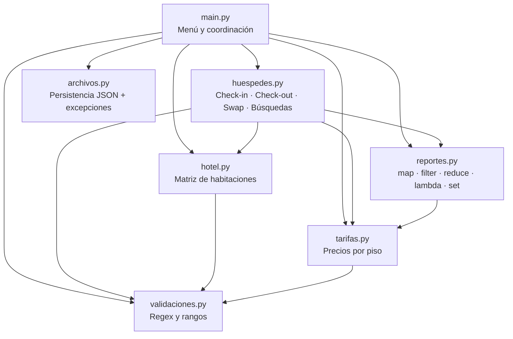
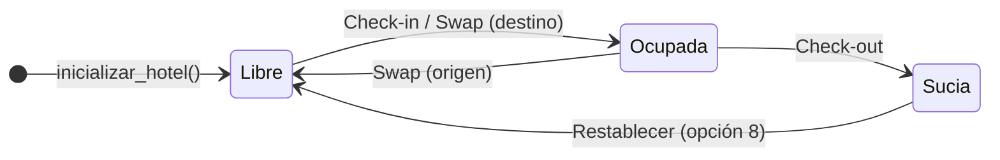
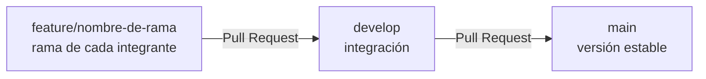

<div align="center">

# 🏨 Room Master

### Sistema de Gestión Hotelera por Consola en Python

*Habitaciones en matriz, huéspedes en diccionarios, identidad en tuplas, unicidad con conjuntos,*
*reportes con programación funcional y persistencia en archivos. Sin clases. Sin bases de datos.*

<br>


**[📄 Documentación oficial (PDF)](Documentacion_Fase2.pdf)** ·
**[🚀 Inicio rápido](#-inicio-rápido)** ·
**[🏗️ Arquitectura](#️-arquitectura)** ·
**[🧪 Pruebas](#-pruebas-unitarias)** ·
**[🎓 Guía de defensa](#-conceptos-de-la-cátedra-y-dónde-encontrarlos)**

</div>

---

## 📑 Tabla de contenidos

1. [Sobre el proyecto](#-sobre-el-proyecto)
2. [Vista rápida](#-vista-rápida)
3. [Funcionalidades](#-funcionalidades)
4. [Inicio rápido](#-inicio-rápido)
5. [Uso del sistema](#️-uso-del-sistema)
6. [Arquitectura](#️-arquitectura)
7. [Modelo de datos](#-modelo-de-datos)
8. [Ciclo de vida de una habitación](#-ciclo-de-vida-de-una-habitación)
9. [Reglas de negocio](#-reglas-de-negocio)
10. [Persistencia](#-persistencia)
11. [Manejo de excepciones](#️-manejo-de-excepciones)
12. [Pruebas unitarias](#-pruebas-unitarias)
13. [Conceptos de la cátedra y dónde encontrarlos](#-conceptos-de-la-cátedra-y-dónde-encontrarlos)
14. [Restricciones técnicas](#️-restricciones-técnicas)
15. [Hoja de ruta](#️-hoja-de-ruta)
16. [Flujo de trabajo en Git](#-flujo-de-trabajo-en-git)
17. [Equipo](#-equipo)

---

## 📌 Sobre el proyecto

**Room Master** es el Trabajo Práctico Integrador de **Algoritmos y Estructura de Datos 1 / Programación 1** (UADE, 2.º cuatrimestre 2026, cátedra del **Lic. Gustavo E. Escandell**).

Resuelve el día a día de la recepción de un hotel: saber qué habitaciones están libres, ocupadas o en limpieza; registrar el ingreso y la salida de huéspedes; mover a un huésped de habitación; cobrar según el piso y la duración de la estadía; y ver indicadores de ocupación y recaudación. Todo queda guardado entre ejecuciones.

| Métrica | Valor |
| :--- | :--- |
| Módulos del sistema | **7** (`main`, `hotel`, `huespedes`, `tarifas`, `reportes`, `validaciones`, `archivos`) |
| Funciones del sistema | **41** (más 12 en `tests.py`) |
| Pruebas unitarias | **10 / 10 aprobadas** (4 válidas · 3 inválidas · 2 límite · 1 adicional) |
| Clases (`class`) | **0** |
| Dependencias externas para ejecutar | **0** (`pytest` es opcional y solo para correr las pruebas) |

---

## 👀 Vista rápida

```text
ROOM MASTER - MENÚ PRINCIPAL

1. Visualizar estado del hotel
2. Check-in (Nuevo huésped)
3. Check-out (Liberar habitación)
4. Reubicar huésped (Swap)
5. Búsquedas
6. Reportes y Facturación
7. Redimensionar hotel
8. Restablecer habitación
0. Salir
==============================
Seleccione una opción: 1

--- ESTADO ACTUAL DEL HOTEL ---
Estados: [L] Libre | [O] Ocupada | [S] Sucia

Piso 3:
[301: L]  [302: O]  [303: L]  [304: L]

Piso 2:
[201: O]  [202: S]  [203: L]  [204: O]

Piso 1:
[101: L]  [102: L]  [103: O]  [104: L]
```

```text
================ CHECK-OUT EXITOSO ================
Huésped:             Juan Perez
Habitación liberada: 201
TOTAL A COBRAR:      $108,000.00
===================================================
```

> Piso 2 configurado como *suite* con +20 % sobre una base de \$10.000 → \$12.000 por noche. 10 noches = \$120.000, menos 10 % por estadía larga = **\$108.000**.

---

## ✨ Funcionalidades

<table>
<tr>
<td width="50%" valign="top">

**🛏️ Operación diaria**
- Grilla visual del hotel por piso con numeración comercial (`101`, `102`, …).
- **Check-in** con validación de habitación, nombre, DNI y días.
- **Check-out** con liquidación automática y pase a estado *Sucia*.
- **Reubicación (Swap)** de un huésped a otra habitación libre.
- **Restablecer habitación** de *Sucia* a *Libre* después de la limpieza.
- **Redimensionar** el hotel (con advertencia y opción de cancelar).

</td>
<td width="50%" valign="top">

**🔎 Búsquedas y reportes**
- Por **DNI** (secuencial), por **nombre parcial** y por **habitación** (`filter` + `lambda`).
- **Ocupación**: total, ocupadas y porcentaje (`map` + `reduce`).
- **Habitaciones libres** por diferencia de conjuntos (`todas - ocupadas`).
- **Recaudación proyectada** (`map` + `reduce` sobre los huéspedes).

</td>
</tr>
<tr>
<td valign="top">

**💲 Tarifas**
- Precio base por noche configurable.
- Pisos *Suite / Lujo* opcionales con recargo porcentual.
- 10 % de descuento para estadías de más de 7 noches.

</td>
<td valign="top">

**🛡️ Robustez**
- Validación con expresiones regulares en todas las entradas.
- Cancelación con `-1` en cualquier operación.
- DNI duplicado bloqueado con un `set`.
- Guardado automático en JSON después de cada operación.

</td>
</tr>
</table>

---

## 🚀 Inicio rápido

**Requisitos:** Python 3.8 o superior (probado en Python 3.14). No hace falta instalar nada para usar el sistema.

```bash
# 1. Clonar el repositorio
git clone https://github.com/lucassebastianramos/room-master.git
cd room-master

# 2. Ejecutar el sistema
python main.py

# 3. Ejecutar las pruebas (sin instalar nada)
python tests.py

# 4. (Opcional) Ejecutar las pruebas con PyTest
python -m pip install pytest
python -m pytest tests.py -v
```

> [!TIP]
> En Windows, si `pytest` muestra *"no se reconoce como cmdlet"*, usá `python -m pytest`. Pasa porque `pip` instala el ejecutable en una carpeta que no está en el `PATH`.

---

## 🕹️ Uso del sistema

### Primer arranque

Si no existe `hotel_data.json`, el sistema pide la configuración inicial y la guarda:

1. Cantidad de **pisos** (1 a 99) y de **habitaciones por piso** (1 a 99).
2. **Precio base** por noche (mayor a 0).
3. Si el hotel tiene más de un piso: si querés **pisos de lujo**, desde qué piso y con qué recargo.

En los arranques siguientes, el hotel se **reconstruye solo** a partir del archivo.

### Menú principal

| Opción | Acción | Qué hace |
| :---: | :--- | :--- |
| `1` | Visualizar estado | Muestra la grilla del piso más alto al más bajo. Hace un salto de línea cada 10 habitaciones. |
| `2` | Check-in | Pide habitación libre, nombre, DNI (no repetido) y días. Marca la habitación `O`. |
| `3` | Check-out | Busca por DNI, calcula el total, marca la habitación `S` y elimina el registro. |
| `4` | Reubicar (Swap) | Mueve al huésped de una habitación a otra libre: origen `L`, destino `O`. |
| `5` | Búsquedas | Submenú: por DNI, por nombre parcial o por número de habitación. |
| `6` | Reportes | Ocupación, habitaciones ocupadas/libres y recaudación proyectada. |
| `7` | Redimensionar | Crea un hotel nuevo. ⚠️ Borra a los huéspedes y pide tarifas nuevas. |
| `8` | Restablecer | Pasa una habitación de `S` (limpieza) a `L` (libre). |
| `0` | Salir | Guarda los datos y termina. |

> [!NOTE]
> **Cancelación universal:** en cualquier pedido de datos podés ingresar `-1` para volver atrás sin modificar el estado del hotel.

---

## 🏗️ Arquitectura

El programa principal **solo coordina**: muestra el menú, llama a las funciones de cada módulo y guarda después de cada operación. La lógica está repartida en módulos con una responsabilidad cada uno. El estado (matriz, huéspedes, tarifas) **viaja por parámetros**, no hay variables globales.



| Módulo | Responsabilidad | Funciones | Biblioteca estándar |
| :--- | :--- | :---: | :--- |
| [`main.py`](main.py) | Menú principal, submenú de búsquedas, carga inicial y guardado | 2 | — |
| [`hotel.py`](hotel.py) | Crear la matriz, convertir índices ↔ número comercial, mostrar la grilla, verificar disponibilidad | 9 | — |
| [`huespedes.py`](huespedes.py) | Check-in, check-out, swap, búsquedas, unicidad de DNI, limpieza | 14 | — |
| [`tarifas.py`](tarifas.py) | Configurar y consultar el precio por piso | 7 | — |
| [`reportes.py`](reportes.py) | Ocupación, subtotal con descuento, recaudación, habitaciones libres | 4 | `functools` |
| [`validaciones.py`](validaciones.py) | Patrones regex, validación genérica, rangos, confirmación s/n | 3 | `re` |
| [`archivos.py`](archivos.py) | Leer y escribir `hotel_data.json` con manejo de excepciones | 2 | `json` |
| [`tests.py`](tests.py) | 10 pruebas unitarias (PyTest y Python puro) | 12 | — |

<details>
<summary><b>📁 Estructura del repositorio</b></summary>

```text
room-master/
├── main.py                    # Punto de entrada: menú y coordinación
├── hotel.py                   # Matriz de habitaciones y numeración comercial
├── huespedes.py               # Operaciones sobre huéspedes
├── tarifas.py                 # Esquema de precios por piso
├── reportes.py                # Reportes con programación funcional y conjuntos
├── validaciones.py            # Validaciones con expresiones regulares
├── archivos.py                # Persistencia JSON con manejo de excepciones
├── tests.py                   # Suite de 10 pruebas unitarias
├── Documentacion_Fase2.pdf    # Documento explicativo oficial (Sección 15)
├── DOCUMENTACION_FASE2.md     # Mismo documento, legible en GitHub
├── documentacion_fase2.html   # Fuente imprimible del PDF
└── README.md
```

`hotel_data.json` se genera al ejecutar el sistema y está en `.gitignore`.

</details>

---

## 🧬 Modelo de datos

Cada estructura se eligió por lo que tiene que hacer el dato, no para cumplir un requisito:

```python
# MATRIZ DEL HOTEL: lista de listas. hotel[piso][habitacion] da el estado en tiempo constante.
hotel = [
    ["L", "O", "L", "L"],   # piso 1 → habitaciones 101..104
    ["O", "S", "L", "O"],   # piso 2 → habitaciones 201..204
]

# HUÉSPED: diccionario (acceso por nombre de campo) que combina una tupla y una lista.
huesped = {
    "identidad": ("40123456", "Juan Perez"),   # tupla: DNI y nombre no cambian nunca
    "dias": 10,                                # entero positivo
    "ubicacion": [1, 0, 201],                  # lista: cambia en el Swap [piso, hab, número]
}

# TARIFAS: matriz [piso_comercial, precio_por_noche]
tarifas = [[1, 10000.0], [2, 12000.0]]

# CONJUNTOS: se arman en el momento para resolver preguntas concretas
dnis_registrados = {"40123456", "38999111"}       # ¿el DNI ya existe? → O(1) promedio
libres = todas - ocupadas                         # ¿qué habitaciones quedan? → diferencia
```

---

## 🔄 Ciclo de vida de una habitación



El estado **Sucia (`S`)** impide volver a alquilar una habitación recién liberada hasta que alguien confirma que se limpió.

---

## 📐 Reglas de negocio

| Regla | Fórmula / criterio | Dónde |
| :--- | :--- | :--- |
| Número comercial | `(piso + 1) * 100 + (habitacion + 1)` → índices `(0, 0)` = **101** | `hotel.obtener_numero_comercial` |
| Número → índices | `piso = n // 100 - 1`, `habitacion = n % 100 - 1` | `hotel.obtener_indices_matriz` |
| Precio de un piso de lujo | `base × (1 + recargo / 100)`, redondeado a 2 decimales | `tarifas.generar_matriz_tarifas` |
| Subtotal de estadía | `precio_noche × días` | `reportes.calcular_subtotal` |
| Descuento por estadía larga | `días > 7` → `subtotal × 0.9` (con `lambda`) | `reportes.calcular_subtotal` |
| Dimensiones válidas | 1 a 99 pisos y 1 a 99 habitaciones por piso | `hotel.reiniciar_matriz` |
| DNI válido | 7 u 8 dígitos (`^\d{7,8}$`) y no repetido | `validaciones` + `huespedes.validar_dni` |
| Nombre válido | solo letras (con tildes y ñ) y espacios | `validaciones.PATRON_TEXTO_VALIDO` |

---

## 💾 Persistencia

| Archivo | Formato | Qué guarda | Cuándo | Estado |
| :--- | :--- | :--- | :--- | :---: |
| `hotel_data.json` | JSON | Dimensiones, tarifas y lista de huéspedes alojados | Al configurar, después de cada operación y al salir | ✅ Implementado |
| `facturacion.txt` | Texto plano | Una línea por check-out (bitácora de caja), modo `"a"` | En cada check-out | 🚧 En desarrollo |
| `facturacion.csv` | CSV | Historial de facturación en columnas para Excel / Google Sheets (`csv.writer`) | A pedido, leyendo el `.txt` | 🚧 En desarrollo |

<details>
<summary><b>Ejemplo de <code>hotel_data.json</code></b></summary>

```json
{
    "pisos": 2,
    "habitaciones": 4,
    "huespedes": [
        {
            "identidad": ["40123456", "Juan Perez"],
            "dias": 10,
            "ubicacion": [1, 0, 201]
        }
    ],
    "tarifas": [[1, 10000.0], [2, 12000.0]]
}
```

JSON no tiene tuplas: `json.dump` guarda la tupla `identidad` como arreglo y `json.load` la devuelve como lista. El sistema accede por índice (`[0]` DNI, `[1]` nombre), así que funciona igual.

</details>

**Recuperación:** al iniciar, `cargar_datos_hotel()` lee el JSON. Si hay datos, `main.py` crea la matriz vacía con `inicializar_hotel()` y marca `O` en la ubicación de cada huésped guardado. Si el archivo no existe, se inicia la configuración guiada.

---

## 🛡️ Manejo de excepciones

`try / except` se usa solo donde el error **no depende del programa** sino del entorno (el archivo). Los datos que ingresa el usuario se validan **antes** con expresiones regulares, así que conversiones como `int(dato)` no pueden fallar.

| Situación | Excepción | Respuesta del sistema |
| :--- | :--- | :--- |
| Primera ejecución, no hay archivo | `FileNotFoundError` | Avisa y arranca la configuración inicial |
| Sin permisos sobre el archivo | `PermissionError` | Informa el problema sin cerrar el programa |
| JSON dañado o con formato inválido | `ValueError` (incluye `json.JSONDecodeError`) / `IndexError` | Informa "registros incorrectos" |
| Datos que no se pueden serializar | `TypeError` / `ValueError` | Informa y devuelve `guardado = False` |
| Otro error de disco o sistema | `OSError` | Muestra el detalle del error |
| Siempre al escribir | bloque `finally` | Cierra el archivo aunque haya fallado la escritura |

---

## 🧪 Pruebas unitarias

[`tests.py`](tests.py) cumple la distribución de la **Sección 9**: 10 pruebas sobre **6 funciones distintas**. Se pueden ejecutar sin abrir el programa principal.

| # | Tipo | Función probada | Situación | Esperado |
| :---: | :--- | :--- | :--- | :--- |
| 01 | ✅ Válido | `hotel.inicializar_hotel` | Hotel de 2 pisos × 3 habitaciones | Matriz 2×3 con `"L"` |
| 02 | ✅ Válido | `tarifas.obtener_tarifa_habitacion` | Precio del piso 2 | `12000.0` |
| 03 | ✅ Válido | `reportes.calcular_subtotal` | 5 noches a \$10.000 | `50000.0` |
| 04 | ✅ Válido | `reportes.calcular_subtotal` | 10 noches a \$10.000 (con descuento) | `90000.0` |
| 05 | ❌ Inválido | Detección con `set` (lógica de `validar_dni`) | DNI que ya está registrado | `True` (duplicado) |
| 06 | ❌ Inválido | `hotel.habitacion_existe` | Piso 5 en un hotel de 2×2 | `False` |
| 07 | ❌ Inválido | `huespedes.buscar_huesped_por_habitacion` | Habitación 999 (no existe) | `[]` |
| 08 | ⚠️ Límite | `reportes.calcular_subtotal` | Exactamente 7 noches (sin descuento) | `70000.0` |
| 09 | ⚠️ Límite | `hotel.inicializar_hotel` | Hotel mínimo 1×1 | `[["L"]]` |
| 10 | ⭐ Adicional | `huespedes.buscar_huespedes_por_nombre` | Buscar `"juan"` entre 3 huéspedes | Juan Perez y Juana Garcia |

```text
$ python -m pytest tests.py -v
tests.py::test_01_inicializacion_matriz_valida PASSED                    [ 10%]
...
tests.py::test_10_busqueda_parcial_nombre_filter_lambda PASSED           [100%]
============================= 10 passed in 0.08s ==============================
```

Con `python tests.py`, cada prueba muestra los **5 datos que pide la consigna**: función, datos, resultado esperado, resultado obtenido y veredicto.

```text
Prueba [04] - CASO VÁLIDO
  1. Función:   reportes.calcular_subtotal
  2. Datos:     huesped={'dias': 10, 'piso': 0 (Piso 1)}, tarifa=$10000.0 (10% desc. > 7 días)
  3. Esperado:  90000.0
  4. Obtenido:  90000.0
  5. Resultado: [APROBADO]
```

---

## 🎓 Conceptos de la cátedra y dónde encontrarlos

Pensado para la **defensa oral**: cada concepto, dónde está y para qué sirve en el sistema.

| Concepto | Dónde | Para qué se usa |
| :--- | :--- | :--- |
| **Matrices** (listas anidadas) | `hotel.inicializar_hotel` | Representar pisos × habitaciones con acceso directo `hotel[p][h]` |
| **Diccionarios** | `huespedes.realizar_checkin`, `archivos.guardar_datos_hotel` | Registro de cada huésped y estructura del archivo JSON |
| **Tuplas** | `"identidad": (dni, nombre)`, `return piso, habitacion` | Datos que no deben cambiar y retornos múltiples |
| **Conjuntos** | `huespedes.validar_dni`, `reportes.reporte_habitaciones_libres` | Detectar DNI duplicados; calcular libres (`-`) y ocupadas (`&`) |
| **`lambda`** | `reportes.calcular_subtotal` | Regla de descuento por estadía larga |
| **`filter`** | `huespedes.buscar_huespedes_por_nombre` / `_por_habitacion` | Búsquedas sobre la lista de huéspedes |
| **`map`** | `reportes.calcular_recaudacion_total`, `generar_reporte_ocupacion` | Transformar huéspedes en montos y filas en cantidades |
| **`reduce`** | `reportes` (3 usos) | Acumular habitaciones, ocupadas y recaudación |
| **Expresiones regulares** | `validaciones.py` | Validar DNI, nombres, números y días |
| **Excepciones** | `archivos.py` | Errores de lectura y escritura de archivos |
| **Archivos JSON** | `archivos.py` + `main.py` | Guardar y recuperar el estado entre ejecuciones |
| **Archivos de texto** | 🚧 `facturacion.txt` | Bitácora de check-outs (en desarrollo) |
| **Pruebas unitarias** | `tests.py` | Verificar 6 funciones con 10 casos |
| **Modularización** | 7 módulos | Una responsabilidad por módulo, sin variables globales |

---

## ⚖️ Restricciones técnicas

| Restricción (Sección 12) | Cumplimiento |
| :--- | :--- |
| 12.1 · Sin clases | ✅ No hay `class`, objetos propios, herencia ni constructores. |
| 12.2 · Sin bases de datos | ✅ La persistencia es solo con archivos (`.json`; `.txt` y `.csv` en desarrollo). |
| 12.3 · Solo librerías vistas en clase | ✅ `re`, `json`, `functools` (y `csv` para la exportación). `pytest` autorizado por la cátedra para las pruebas. |
| 12.4 · Código explicable | ✅ Sin decoradores, generadores ni construcciones avanzadas fuera del programa. |

---

## 🗺️ Hoja de ruta

- [x] Modularización en 7 archivos
- [x] Huésped como diccionario con tupla de identidad
- [x] Conjuntos para unicidad de DNI y habitaciones libres
- [x] Persistencia y recuperación en JSON
- [x] Manejo de excepciones en archivos
- [x] 10 pruebas unitarias compatibles con PyTest
- [ ] Bitácora de check-outs en `facturacion.txt` (escritura en modo `"a"`, lectura y uso posterior)
- [ ] Exportación de facturación a `facturacion.csv` con `csv.writer`

**Mejoras identificadas para próximas versiones:**

- Guardar también el estado `S` de las habitaciones: hoy la matriz se reconstruye solo a partir de los huéspedes, así que las habitaciones en limpieza vuelven como `L` al reiniciar.
- Convertir `identidad` de nuevo a tupla al cargar el JSON (`tuple(h["identidad"])`) para mantener la inmutabilidad después de reiniciar.
- Si el JSON está dañado, avisar antes de volver a configurar el hotel, para no sobrescribir el archivo original.

---

## 🌿 Flujo de trabajo en Git



```bash
git checkout develop && git pull origin develop    # traer lo último
git checkout feature/mi-rama && git merge develop  # actualizar mi rama
git add . && git commit -m "feat: descripción del cambio"
git push origin feature/mi-rama                    # y abrir un Pull Request a develop
```

`main` está protegida: solo recibe cambios mediante Pull Request.

---

## 👥 Equipo

<div align="center">

| Integrante | Rol |
| :--- | :--- |
| **Menendez Mojana, Tiara** | Referente del grupo |
| **Ramos, Lucas Sebastián** | Desarrollo |
| **Iglesias, Luca** | Desarrollo |
| **Rueda, Leandro Nicolás** | Desarrollo |

**Universidad Argentina de la Empresa (UADE)** · Algoritmos y Estructura de Datos 1 / Programación 1
Docente: **Lic. Gustavo E. Escandell** · 2.º cuatrimestre 2026

</div>
